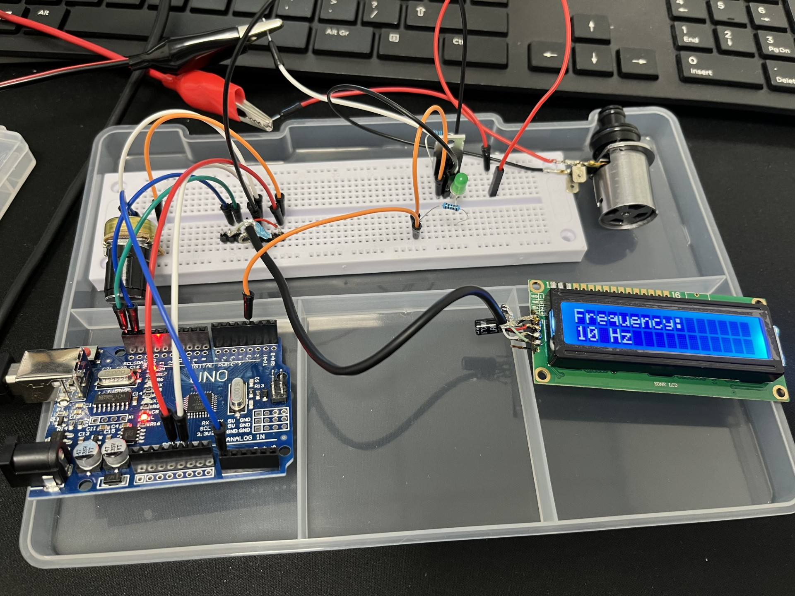

# TR580 – Potentiometer to 0–100 Hz pulse generator, control a solenoid using IRF540

Arduino Uno sketch that reads a potentiometer on A0 and outputs a 50% duty square wave of 0–100 Hz on D3. The current frequency is shown on a 16x2 I2C LCD (LCD1602).




## Hardware

| Part | Connection |
|------|------------|
| Potentiometer wiper | A0 (outer pins to 5V and GND) |
| Pulse output | D3 |
| LCD1602 I2C – SDA | A4 |
| LCD1602 I2C – SCL | A5 |
| LCD1602 I2C – VCC / GND | 5V / GND |

The LCD I2C address defaults to `0x27`. If the display stays blank, change `LCD_ADDR` in `TR580.ino` to `0x3F`.

## How it works

- A0 is averaged over 8 samples and mapped to 0–100 Hz in 1 Hz steps.
- Timer1 (CTC mode, prescaler 256) toggles D3 in an interrupt, so the timing is not affected by LCD updates.
- At 0 Hz the output stays low.
- The LCD only redraws when the value changes.

## Requirements

- [Arduino CLI](https://arduino.github.io/arduino-cli/) (set the path in `arduino.bat`, currently `C:\arduino-cli_1.5.1_Windows_64bit`)
- Core `arduino:avr`
- Library `LiquidCrystal_I2C`

## Usage

Run from this folder:

```bat
arduino build            :: compile
arduino upload [port]    :: upload (default port COM10)
arduino monitor [port]   :: serial monitor at 9600 baud (Ctrl+C to exit)
arduino all [port]       :: build, upload, then monitor
```

The port can also be set with the `PORT` environment variable. The sketch does not currently print to Serial, so the monitor is empty unless you add output.

## Files

- `TR580.ino` – sketch
- `arduino.bat` – build/upload/monitor helper
